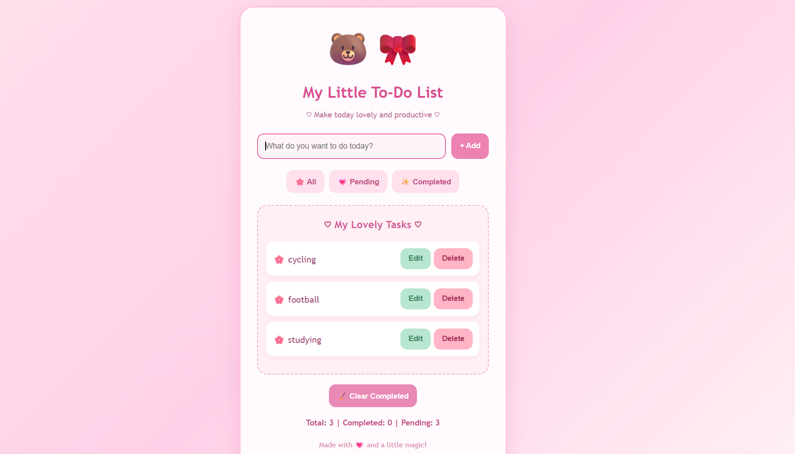

Ex03 To-Do List using JavaScript
Date:16.11.2026

## AIM
To create a To-do Application with all features using JavaScript.
## ALGORITHM
STEP 1
Build the HTML structure (index.html).
STEP 2
Style the App (style.css).
STEP 3
Plan the features the To-Do App should have.
STEP 4
Create a To-do application using Javascript.
STEP 5
Add functionalities.
STEP 6
Test the App.
STEP 7
Open the HTML file in a browser to check layout and functionality.
STEP 8
Fix styling issues and refine content placement.
STEP 9
Deploy the website.
STEP 10
Upload to GitHub Pages for free hosting.

## PROGRAM
HTML

```
<!DOCTYPE html>
<html>
<head>
    <title>My Cute Todo List</title>
    <link rel="stylesheet" href="style.css">
</head>
<body>

    <div class="container">

        <div class="cartoon">🐻🎀</div>

        <h1>My Little To-Do List</h1>
        <p class="subtitle">♡ Make today lovely and productive ♡</p>

        <div class="input-area">
            <input type="text" id="taskInput" placeholder="What do you want to do today?">
            <button class="add-btn" onclick="addTask()">+ Add</button>
        </div>

        <div class="filters">
            <button onclick="setFilter('all')">🌸 All</button>
            <button onclick="setFilter('pending')">💗 Pending</button>
            <button onclick="setFilter('completed')">✨ Completed</button>
        </div>

        <div class="task-box">
            <h3>♡ My Lovely Tasks ♡</h3>
            <ul id="taskList"></ul>
        </div>

        <button class="clear-btn" onclick="clearCompleted()">
            🧹 Clear Completed
        </button>

        <h3 id="count">Total: 0 | Completed: 0 | Pending: 0</h3>

        <p class="footer">Made with 💗 and a little magic!</p>

    </div>

    <script src="script.js"></script>

</body>
</html>

```
CSS
```

* {
    box-sizing: border-box;
}

body {
    font-family: 'Trebuchet MS', Arial, sans-serif;
    background: linear-gradient(135deg, #ffe0ec, #ffd1e8, #fff0f5);
    min-height: 100vh;
    display: flex;
    justify-content: center;
    align-items: center;
    padding: 25px;
    margin: 0;
}

.container {
    background: #fffafd;
    width: 100%;
    max-width: 480px;
    padding: 30px;
    border-radius: 25px;
    text-align: center;
    box-shadow: 0 10px 35px rgba(220, 90, 150, 0.2);
    border: 3px solid #ffc4dd;
}

.cartoon {
    font-size: 65px;
    margin-bottom: 5px;
    animation: bounce 2s infinite;
}

@keyframes bounce {
    0%, 100% {
        transform: translateY(0);
    }
    50% {
        transform: translateY(-8px);
    }
}

h1 {
    color: #d94f91;
    font-size: 28px;
    margin-bottom: 8px;
}

.subtitle {
    color: #bd7299;
    font-size: 14px;
    margin-bottom: 25px;
}

.input-area {
    display: flex;
    gap: 10px;
    margin-bottom: 20px;
}

input {
    flex: 1;
    min-width: 0;
    padding: 13px;
    border: 2px solid #ffc1da;
    border-radius: 12px;
    outline: none;
    font-size: 14px;
    background: #fff4f8;
}

input:focus {
    border-color: #e66ba5;
}

button {
    border: none;
    padding: 11px 15px;
    border-radius: 12px;
    cursor: pointer;
    font-weight: bold;
    transition: 0.3s;
}

button:hover {
    transform: scale(1.05);
}

.add-btn {
    background: #ed82b2;
    color: white;
}

.filters {
    display: flex;
    justify-content: center;
    gap: 8px;
    flex-wrap: wrap;
    margin-bottom: 22px;
}

.filters button {
    background: #ffe0ed;
    color: #c34d86;
}

.filters button:hover {
    background: #f6b5d1;
}

.task-box {
    background: #fff0f6;
    padding: 15px;
    border-radius: 18px;
    border: 2px dashed #f4b1cf;
}

.task-box h3 {
    color: #d65c96;
    margin-top: 5px;
}

ul {
    padding: 0;
}

li {
    list-style: none;
    background: white;
    padding: 12px;
    margin: 10px 0;
    border-radius: 12px;
    display: flex;
    align-items: center;
    justify-content: space-between;
    gap: 5px;
    flex-wrap: wrap;
    box-shadow: 0 3px 8px rgba(220, 100, 150, 0.1);
    color: #a64d79;
}

li span {
    flex: 1;
    text-align: left;
    cursor: pointer;
    overflow-wrap: anywhere;
}

.completed {
    text-decoration: line-through;
    color: #c5a2b4;
}

.edit {
    background: #b8e6d0;
    color: #347d5a;
}

.delete {
    background: #ffb5c5;
    color: #a72e56;
}

.clear-btn {
    background: #e989b5;
    color: white;
    margin-top: 18px;
}

#count {
    color: #c34d86;
    font-size: 14px;
    margin-top: 20px;
}

.footer {
    color: #d77ba7;
    font-size: 13px;
    margin-top: 22px;
}

@media (max-width: 500px) {
    .container {
        padding: 20px;
    }

    h1 {
        font-size: 23px;
    }

    .input-area {
        flex-wrap: wrap;
    }

    .input-area input {
        width: 100%;
    }
}

```

## OUTPUT



## RESULT
The program for creating To-do list using JavaScript is executed successfully.